# DESIGN.md — Mollie payments for OroCommerce

Living architecture record. Describes the system **as it is** on branch `master` (OroCommerce 6, Symfony bundle `Mollie\Bundle\PaymentBundle`, package `mollie/orocommerce` 6.2.3). Any architectural change updates this file, including its diagrams, in the same pass.

## 1. Purpose

This package lets an OroCommerce 6 shop take payments through Mollie. It is one Symfony bundle, `MolliePaymentBundle` (`MolliePaymentBundle.php`), installed with Composer. The PSR-4 root `Mollie\Bundle\PaymentBundle\` is the repository root. The bundle is registered through `Resources/config/oro/bundles.yml` with priority 56, so it loads after the Oro Integration, Order and Checkout bundles.

The shop admin creates one Oro integration channel of type `mollie_payment_channel` per Mollie organization access token. Every Mollie method that is active on the selected Mollie website profile becomes one Oro payment method. Its identifier is `mollie_payment_<channelId>_<mollieId>`. Each channel also gets the extra method `mollie_admin_link`, which the admin payment link uses.

The integration channel form covers these settings:
- the organization access token and the test/live environment
- the website profile
- per method: names, descriptions, payment and transaction descriptions, a custom logo, surcharge (type, fixed amount, percentage, limit), Mollie Components and single-click payment for credit cards, issuer list style, voucher category and product attribute, order and payment expiry days, and capture mode

The bundle covers the rest:
- storefront method listing filtered by billing country, amount, currency and voucher category, with Mollie Components, issuer selection, Apple Pay detection and a payment surcharge subtotal
- payment creation when the checkout purchases, through the Mollie Payments API
- the redirect return and the webhook
- back-office order operations on `oro_order_view`: manual capture, refund, and generating an admin payment link
- the storefront admin-payment-link landing route that starts a new Mollie payment for an existing order
- propagating Oro order changes to Mollie: a cancel cancels the Mollie payment; a total change or close is rejected; a delete removes the order reference
- a notifications grid on the channel form, fed by the core `NotificationHub`

Business logic lives in a copied `mollie/integration-core`, re-namespaced to `Mollie\Bundle\PaymentBundle\IntegrationCore\*`. It covers the API proxy, payment, refund, order and checkout-link services, order and customer references, webhook dispatch, notifications, the ORM abstraction and configuration. This repository is the Oro wrapper. It implements the core's integration interfaces and maps Oro checkouts, orders and payment transactions to Mollie DTOs.

## 2. Architecture overview

The design has four layers, and dependencies point downward:

1. **Oro platform entry points.** Oro and Symfony invoke these thin adapters:
   - the Oro payment method registries (the tagged `oro_payment.payment_method_provider` and `oro_payment.payment_method_view_provider`)
   - the Oro payment callback events `oro_payment.callback.notify` and `oro_payment.callback.return`
   - the bundle's own routes (`Controller/`, `Resources/config/oro/routing.yml`)
   - the Oro integration channel form (`oro_integration.channel` / `oro_integration.transport`)
   - the Oro operations on `oro_order_view` (`Resources/config/oro/actions.yml`)
   - Doctrine entity listeners on `Order`, `OrderLineItem`, `OrderAddress`, `Checkout`, `Channel` and `ChannelSettings`
   - kernel and datagrid listeners
   - layout block themes and JS page components (`jsmodules.yml` dynamic imports, built by the shop's Oro asset build)
   - Oro migrations
2. **Wrapper** (`Mollie\Bundle\PaymentBundle\*` outside `IntegrationCore/`). This layer holds `IntegrationServices\BootstrapComponent`, the Oro payment method, config, view and factory classes (`PaymentMethod/`), the DTO mapper (`Mapper/`), the managers used by operations and controllers (`Manager/`), the core boundary implementations (`IntegrationServices/`) and the Doctrine entities and repositories (`Entity/`).
3. **Copied core** (`IntegrationCore/BusinessLogic`, `IntegrationCore/Infrastructure`; base integration-core 1.3.4 with local edits). It provides:
   - `ServiceRegister`, `RepositoryRegistry` and `EventBus`
   - `Proxy`, `BaseProxy` and `Http\OrgToken\ProxyDataProvider`
   - `PaymentService`, `OrderService`, `RefundService`, `CheckoutLinkService`, `OrderReferenceService`, `CustomerService` and `CustomerReferenceService`
   - `PaymentMethodService`, `SurchargeService` and `OrgTokenAuthService`
   - `WebHookTransformer` with its webhook handlers, and the `IntegrationOrder*EventHandler` classes
   - `NotificationHub`, `VersionCheckService` and `Configuration`
   - the UI controllers `WebsiteProfileController`, `PaymentMethodController` and `NotificationController`
4. **External systems and persistence.** These are:
   - the Mollie API v2, Mollie.js, and the version-check URL on `raw.githubusercontent.com`
   - the Oro database: `mollie_entity`, `mollie_payment_settings` and its localized-value join tables, `oro_integration_transport.mollie_save_marker`, the extended columns `oro_order.mollie_surcharge_amount`, `oro_checkout.mollie_surcharge_amount` and `oro_product.mollie_voucher_category`, and the Oro order, payment-transaction and integration tables
   - uploaded method logos under `public/bundles/molliepayment/img/uploads`
   - the Monolog channel `mollie`

The core calls back into the wrapper only through registered interfaces and abstract classes:
- `Integration\Interfaces\OrderTransitionService` → `IntegrationServices\OrderTransitionService`
- `Integration\Interfaces\OrderLineTransitionService` → `IntegrationServices\OrderLineTransitionService`
- `Infrastructure\Configuration\Configuration` / `BusinessLogic\Configuration` → `IntegrationServices\ConfigurationService`
- `Infrastructure\Logger\Interfaces\ShopLoggerAdapter` → `IntegrationServices\LoggerAdapter`, which delegates to `LoggerService`
- `BusinessLogic\ORM\Interfaces\RepositoryInterface` → `Entity\Repository\MollieBaseEntityRepository`, `MollieContextAwareEntityRepository` and `MollieNotificationEntityRepository`
- `BusinessLogic\VersionCheck\VersionCheckService` (abstract `flashMessage()`) → `IntegrationServices\VersionCheckService`
- `BusinessLogic\PaymentMethod\PaymentTransactionDescriptionService` (abstract `getDescription()`) → `IntegrationServices\TransactionDescriptionService`
- `Authorization\Interfaces\AuthorizationService` → the core `OrgToken\OrgTokenAuthService`, resolved from the Symfony container

All Mollie HTTP goes through the core `Proxy`/`BaseProxy`, which wraps `CurlHttpClient` in `LoggingHttpClient`. The `mollie/mollie-api-php` SDK is not used.

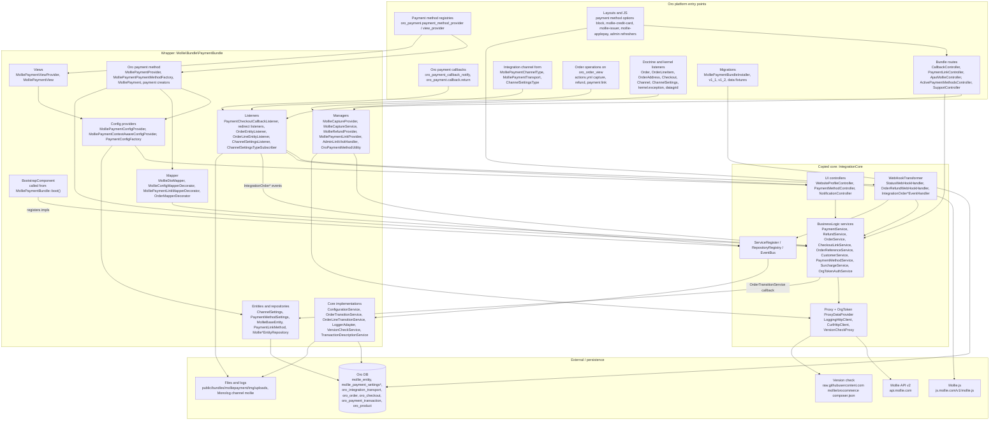

## 3. Key components

| Component | Responsibility | Collaborators |
|---|---|---|
| `MolliePaymentBundle` (`MolliePaymentBundle.php`) | Symfony bundle. `boot()` calls `IntegrationServices\BootstrapComponent::boot($this->container)` on every kernel boot. `getContainerExtension()` returns `DependencyInjection\PaymentExtension`, which loads `services.yml` and `listeners.yml`. | `BootstrapComponent`, `PaymentExtension` |
| `BootstrapComponent` (`IntegrationServices/`) | Composition root for the core. It extends the core `BusinessLogic\BootstrapComponent`, keeps the Symfony container in a static field, and guards `init()` with a static flag. `initServices()` registers in `ServiceRegister`: the container itself under `ContainerInterface::class`; `Configuration`, `ShopLoggerAdapter`, `OrderTransitionService`, `OrderLineTransitionService`, `AuthorizationService`, `OrgToken\ProxyDataProvider` and `VersionCheckService`, all as closures over `$container->get(...)`; and `HttpClient` as `new CurlHttpClient()`. `initRepositories()` maps `ConfigEntity`, `OrderReference`, `PaymentLinkMethod` and `CustomerReference` to `MollieBaseEntityRepository`, `PaymentMethodConfig` to `MollieContextAwareEntityRepository`, and `Notification` to `MollieNotificationEntityRepository`. The parent registers `Proxy`, `VersionCheckProxy`, the business services and the `EventBus` subscriptions for webhook and `IntegrationOrder*` events. | core `ServiceRegister`, `RepositoryRegistry`, `EventBus`; Symfony container |
| `MolliePaymentChannelType`, `MolliePaymentTransport` (`Integration/`) | Oro integration channel type `mollie_payment_channel` with icon `bundles/molliepayment/img/mollie-logo.png`. The transport has settings form `ChannelSettingsType` and settings entity `ChannelSettings`. | Oro IntegrationBundle |
| `ChannelSettingsType` + `ChannelSettingsTypeSubscriber` (`Form/`) | The channel settings form: `authToken` (`MolliePasswordType`), `testMode`, the hidden markers `mollieSaveMarker`, `formRefreshRequired`, `isTokenOnlySubmit` and `mollieVersion`, and, once a token is valid, `websiteProfile` plus a `paymentMethodSettings` collection of `PaymentMethodSettingsType`. The subscriber validates the token through `AuthorizationService::validateToken` (cached per token), loads token, test mode and profile from `Configuration` in the channel context, fetches profiles and method configs from the core UI controllers, and runs `VersionCheckService::checkForNewVersion()` in `POST_SET_DATA`. | `Configuration`, `OrgTokenAuthService`, `WebsiteProfileController`, `PaymentMethodController`, `VersionCheckService` |
| `ChannelSettingsListener` (`EventListener/`) | Doctrine listener on `Channel` `postPersist` and `ChannelSettings` `postUpdate`. It uploads new method logos through `FileUploader` (prefix `<channelId>-<profileId>-<mollieId>`). In the channel context it stores the token and test mode, saves the website profile (removing logos of a replaced profile), copies per-method settings into the core `PaymentMethodConfig` and saves them. The capture mode defaults to `manual` for `CaptureModeRestrictions::MANUAL_ONLY` and to `automatic` otherwise. | `Configuration`, `WebsiteProfileController`, `PaymentMethodController`, `FileUploader` |
| `MolliePaymentConfigProvider` / `MolliePaymentContextAwareConfigProvider` (`PaymentMethod/Config/Provider/`) | Build the `MolliePaymentConfig` list. For each enabled `ChannelSettings` (`ChannelSettingsRepository::getEnabledSettings()`, ACL-filtered), the provider runs in the channel context and loads the core method configs. The base provider calls `PaymentMethodController::getAll()`. The context-aware one calls `getEnabled(profile, billing country, amount, voucher categories)` and drops `voucher` when the cart has no categories. It merges the stored `PaymentMethodSettings` and creates one `mollie_admin_link` config from the first enabled setting. Results are cached per instance (the context-aware provider caches per context key). | `PaymentConfigFactory`, core UI controllers, Doctrine |
| `PaymentConfigFactory` + `PaymentConfigIdentifierGenerator` | Map a `PaymentMethodSettings` to a `MolliePaymentConfig`. The mapped fields are: localized labels and descriptions; identifier `mollie_payment_<channelId>_<mollieId>` (or `mollie_admin_link`); token and test mode from the channel context; profile id; surcharge; Components and single-click (credit card only); issuers (from `getEnabled()` for issuer-list methods); expiry days; voucher settings. | `Configuration`, `LocalizationHelper`, `PaymentMethodController` |
| `MolliePaymentProvider`, `MolliePaymentPaymentMethodFactory`, `MolliePayment` (`PaymentMethod/`) | The Oro payment method. `MolliePayment` implements `PaymentMethodInterface`, `PurchaseActionInterface` and `CaptureActionInterface`, and supports `purchase` and `capture`. `purchase()` creates the Mollie payment in the channel context, stores the Mollie id as the transaction `reference`, sets the action to `pending` with active/successful `true`, and returns `purchaseRedirectUrl`. `capture()` always returns `successful: false` with `mollie.payment.capture.message`, so captures run only through the Mollie capture operation. `isApplicable()` asks the context-aware provider. The factory wires `MolliePaymentApiPaymentCreator` with `MollieConfigMapperDecorator`; for `mollie_admin_link` it uses `MolliePaymentLinkPaymentCreator` with `MolliePaymentLinkMapperDecorator`. | core `PaymentService`, `MollieDtoMapper`, config providers, `RouterInterface` |
| `MolliePaymentViewProvider` + `MolliePaymentView` (`PaymentMethod/View/`) | Storefront view per config, rendered in block `_payment_methods_mollie_payment_widget`. The options are: icon; surcharge amount (core `SurchargeService`); Components and single-click flags (off when more than one Mollie credit-card method applies); save/use-saved-card checkboxes (core `CustomerReferenceService`); issuers and issuer list style; profile id and test mode for Mollie.js; payment description. | core `SurchargeService`, `CustomerReferenceService`, Oro `ApplicablePaymentMethodsProvider` |
| `MollieDtoMapper` + decorators (`Mapper/`, `PaymentMethod/Factory/`) | `getPaymentData()` builds the core `Payment` DTO. The fields are: locale; amount from the transaction; metadata `order_id` (entity id); `redirectUrl` = `mollie_payment_callback_return`; `webhookUrl` = `oro_payment_callback_notify` with access identifier and token; `issuer`, `cardToken` and single-click fields read from `oro_workflow_transition[<method>-mollie-*]`; a Mollie customer (`CustomerService::createCustomer`) for single-click; shipping and billing addresses; description from `TransactionDescriptionService`; order lines with tax plus shipping, surcharge and discount lines. `MollieConfigMapperDecorator` adds `profileId`, `methods = [mollieId]` and the due date. `MolliePaymentLinkMapperDecorator` replaces `methods` with the admin-selected methods from `PaymentLinkMethod`. `ensureDebugWebhookUrl()` swaps the host for `%mollie_payment.webhooks_url_replacement%` when debug mode is on. | core `PaymentService`, `CustomerService`, `CustomerReferenceService`, Oro tax, surcharge, router, localization |
| `PaymentCheckoutCallbackListener` (`EventListener/Callback/`) | Listener on `oro_payment.callback.notify`, the webhook. Inside `WebHookContext` it checks the transaction, main request, payment method and order, then calls `WebHookTransformer::handle(raw body)` in the channel context, flushes the order and transaction, and marks the event successful. A missing order pushes a `NotificationHub` error and marks success. Any exception marks the transaction unsuccessful and leaves the event failed. | core `WebHookTransformer`, `MolliePaymentProvider`, `DoctrineHelper` |
| `CallbackController` (`Controller/`) | Route `mollie_payment_callback_return` (`/payment/callback/mollie/return/{accessIdentifier}`, frontend). It fetches the payment by order entity id in the channel parsed from the method identifier. A status other than `failed` or `canceled` dispatches Oro `CallbackReturnEvent`; otherwise it adds a flash error and dispatches `CallbackErrorEvent`. The fallback redirect is `oro_checkout_frontend_checkout`. | core `PaymentService`, Oro event dispatcher |
| `PaymentCheckoutRedirectListener`, `AdminLinkPaymentRedirectListener` | Listeners on `oro_payment.callback.return`, priorities −100 and −200. The first redirects to `oro_frontend_root` when the order is missing, and to the transaction `failureUrl` when the transaction is not successful (skipping `mollie_admin_link`). The second handles only `mollie_admin_link`: success gets a thank-you flash, failure redirects to `failureUrl` with a link back to `mollie_payment_link`. | Oro `PaymentResultMessageProvider`, router |
| `OrderTransitionService` (`IntegrationServices/`) | Core `OrderTransitionService`. It updates the latest Oro `PaymentTransaction` and the order `internalStatus` (enum `order_internal_status`): - `payOrder` → action `capture`, status `open` - `completeOrder` → `capture`, `closed` - `authorizeOrder` → `authorize` - `cancelOrder` / `expireOrder` → inactive, unsuccessful, `cancelled` - `failOrder` → `purchase`, unsuccessful, `cancelled` - `refundOrder` → `closed` A failure pushes a `NotificationHub` warning. It resolves the status through `EnumOption` (Oro 6.1+) or the extend enum class (earlier). | `PaymentTransactionProvider`, `DoctrineHelper` |
| `OrderLineTransitionService` | Core `OrderLineTransitionService`. `cancelOrderLine` and `refundOrderLine` push info notifications. The other methods do nothing. | `NotificationHub` |
| `OrderEntityListener`, `OrderLineEntityListener` (`EventListener/`) | Doctrine `preUpdate` and `preRemove` on `Order`, `OrderAddress` and `OrderLineItem` for orders whose last transaction is a Mollie method. In the channel context they fire: - `IntegrationOrderShippedEvent`, `IntegrationOrderClosedEvent` or `IntegrationOrderCanceledEvent` on an internal-status change - `IntegrationOrderTotalChangedEvent` on a `totalValue` change - `IntegrationOrderBillingAddressChangedEvent` / `IntegrationOrderShippingAddressChangedEvent` on an address change - `IntegrationOrderDeletedEvent` on remove - `IntegrationOrderLineChangedEvent` on a change of `freeFormProduct`, `quantity` or `priceType` Handler exceptions become `MollieOperationForbiddenException`. | core `EventBus`, `OrderReferenceService`, `MollieDtoMapper` |
| `MollieCaptureProvider` + `MollieCaptureService` (`Manager/`) | Operation `mollie_payment_capture`. It is shown when the order has a Mollie config and an active successful `authorize` transaction with no successful `capture`. The service resolves the Mollie id from `OrderReference` (by `Order::getId()`) and computes the summary: authorized, captured, remaining and currency, from `Proxy::getPayment` and `getCaptures`. It rejects an amount ≤ 0 or above the remaining amount, then calls `Proxy::createCapture`. | core `Proxy`, `OrderReferenceService`, `OroPaymentMethodUtility` |
| `MollieRefundProvider` + `VoucherRefundFormProvider` | Operation `mollie_payment_refund`. It is shown for Mollie orders that have an `OrderReference`, that are not voucher-only, and that are not in the authorized-only state. The form is prefilled with the refundable amount: captured amount (or payment amount) minus `amountRefunded`. A submit calls core `RefundService::refundPayment`, or `refundWholeOrder` for Orders API references created by earlier versions. Voucher payments show a reminder-method form. | core `RefundService`, `PaymentService`, `OrderService`, `Proxy` |
| `MolliePaymentLinkProvider`, `AdminLinkVisitHandler`, `PaymentLinkController` | Admin payment link. The operation `mollie_payment_link_generation` is shown while the Oro payment status is not `full`. It shows the storefront URL of `mollie_payment_link` (rewritten to the order's website URL) and stores the selected Mollie methods as `PaymentLinkMethod`. The storefront route requires `oro_order_frontend_view` (`#[AclAncestor]`; the param converter checks VIEW on that order, so only the order's customer user or a customer user with deeper access passes, and guests are denied). It deactivates non-Mollie transactions, creates and executes a `mollie_admin_link` purchase transaction (success and failure URL = `oro_order_frontend_view`), then redirects to `CheckoutLinkService::getCheckoutLink()`. | `PaymentTransactionProvider`, `CompositePaymentMethodProvider`, core `CheckoutLinkService` |
| `OroPaymentMethodUtility` | Resolves an order's payment key, Mollie config and channel id from its last payment transaction. Also answers `isPaymentAuthorizedOnly`, lists the available configs of the first channel for the payment link, and builds voucher payment labels for the `view_general_section_after` placeholder. | `PaymentTransactionProvider`, config provider, `OrderReferenceService` |
| Surcharge (`CheckoutEntityListener`, `Provider/MollieSurchargeProvider`, `Mapper/OrderMapperDecorator`, `EventListener/MollieSurchargeListener`, `Entity/GeneratorExtension/…`) | `CheckoutEntityListener` computes `Checkout.mollieSurchargeAmount` on `prePersist`/`preUpdate` through core `SurchargeService`. `MollieSurchargeProvider` is the subtotal provider `mollie_payment_surcharge` (priority 25). `OrderMapperDecorator` decorates `oro_checkout.mapper.order_mapper` and copies the amount to `Order`. `MollieSurchargeListener` adds it to the Oro payment surcharge handling amount. The generator extension makes the extended `Order` and `Checkout` implement `MollieSurchargeAwareInterface`. | core `SurchargeService`, Oro pricing/checkout |
| `ConfigurationService` (`IntegrationServices/`) | Core `Configuration` singleton, configured through `create()`. It provides: - integration name `oro/commerce`, version from `PackageProvider` - extension name `MollieOroCommerce` - extension version from the installed `mollie/orocommerce` package, falling back to `%mollie_payment.version%` - `VERSION_CHECK_URL` and `PLUGIN_DOWNLOAD_URL` - system id and name from the current website (falling back to the default website) `isSystemSpecific()` returns `false`. | `PlatformVersionReader`, `WebsiteManager` |
| `LoggerService` + `LoggerAdapter` | Core `ShopLoggerAdapter`. Writes `MOLLIE LOG: …` lines to Monolog channel `mollie` when the level is ≤ `getMinLogLevel()` or debug mode is on. `ERROR` → `error()`, other levels → `warning()`. | `Psr\Log\LoggerInterface`, `Configuration` |
| `MollieBaseEntityRepository` family (`Entity/Repository/`) | Core `RepositoryInterface` over the Doctrine entity `MollieBaseEntity` (table `mollie_entity`). It builds DQL with the Oro entity manager from `ServiceRegister(ContainerInterface)`. `MollieContextAwareEntityRepository` filters and stamps the `context` column with `Configuration::getContext()`. `MollieNotificationEntityRepository` uses a separate `EntityManager` so notifications survive an outer rollback. | Oro `DoctrineHelper`, core `IndexHelper`, `QueryFilter` |
| `DatagridsListener` | Fills the array datasource of `mollie-notifications-grid` from core `NotificationController::get(limit, offset)` in the grid's `channelId` context. | core `NotificationController` |
| `AjaxMollieController`, `ActivePaymentMethodsController`, `SupportController`, `KernelEventListener` | Back-office endpoints: - `POST /mollie/validate-connection/{channelId}/` (`oro_integration_update` + CSRF) validates the posted token through the channel form - `GET /mollie/methods/active/{channelId}/{profileId}` (`oro_integration_view`) lists the enabled methods for a profile - `/mollie/support/status` reads (GET, `oro_integration_view`) or sets (POST, `oro_integration_update` + CSRF) `debugModeEnabled` - `/mollie/support/download_debug_data` (`oro_integration_update`) returns a ZIP of `phpinfo`, all `OrderReference` rows and `%kernel.logs_dir%` files through `DebugService` `KernelEventListener` turns `MollieOperationForbiddenException` into a JSON 422 response. | `Configuration`, core `PaymentMethodService`, `DebugService` |
| Migrations (`Migrations/`) | `MolliePaymentBundleInstaller` (`v1_0`) adds `oro_integration_transport.mollie_save_marker`, creates `mollie_entity`, `mollie_payment_settings`, `mollie_payment_settings_desc` and `mollie_payment_settings_name`, and adds `mollie_surcharge_amount` to `oro_order` and `oro_checkout`. `v1_1` adds the payment and transaction description tables and the `oro_product.mollie_voucher_category` enum attribute. `v1_2` adds the single-click tables. The data fixtures load the voucher enum values and add the attribute to the default product family. | Oro MigrationBundle, EntityExtendBundle |

## 4. Domain model

Every entity and participant in sections 4 and 5 is labelled with the system that owns it:

| Label | Owner |
|---|---|
| `«oro»` | OroCommerce/Oro platform: entities (`Order`, `OrderLineItem`, `OrderAddress`, `Checkout`, `PaymentTransaction`, `Channel`, `Transport`, `Product`, `CustomerUser`, `LocalizedFallbackValue`), the checkout workflow, payment providers and callbacks, integration, operations, datagrid and layout frameworks |
| `«mollie-oro»` | This repository's wrapper code (everything outside `IntegrationCore/` and `Tests/`) |
| `«mollie-core»` | The copied core under `IntegrationCore/` (integration-core 1.3.4 base with local edits) |
| `«mollie-api»` | The external Mollie API and its resources |
| `«mollie-js»` | Mollie Components script `js.mollie.com/v1/mollie.js` (sequence diagrams only) |
| `«github»` | GitHub raw content, used by the version check (sequence diagrams only) |
| `«shopper»`, `«admin»`, `«browser»` | People and the browser (sequence diagrams only) |

Class diagrams put the label inside the class as an annotation (`<<oro>>`). In sequence diagrams the label is the first line of the participant alias, followed by ` ` and the name, with no quotes: `participant PTP as «oro» PaymentTransactionProvider`. `<` and `>` inside names are written `#lt;` and `#gt;`. New diagrams, including those in plans, follow the same convention.

`ChannelSettings` and `PaymentMethodSettings` are Doctrine entities of this repository. Only `mollieSaveMarker`, `mollieMethodId`, `mollieMethodDescription` and the localized collections are mapped. Token, test mode, website profile and the per-method option fields are transient: they are loaded from and written to core entities. `PaymentLinkMethod` is a core-ORM entity defined in this repository. `MolliePaymentConfig` is a runtime value object. The `«mollie-core»` entities are defined by the core and persisted by this repository's repositories into `mollie_entity`. `MolliePaymentResource` is the Mollie payment resource, carried as the core DTO `Http\DTO\Payment`.

```mermaid
classDiagram
    class Channel {
        <<oro>>
        +id
        +type "mollie_payment_channel"
        +enabled
        +organization
    }
    class ChannelSettings {
        <<mollie-oro>>
        +mollieSaveMarker
        +authToken "transient"
        +testMode "transient"
        +websiteProfile "transient"
    }
    class PaymentMethodSettings {
        <<mollie-oro>>
        +mollieMethodId
        +mollieMethodDescription
        +names, descriptions
        +paymentDescriptions, transactionDescriptions
        +singleClickPaymentApprovalText, singleClickPaymentDescription
        +surcharge, captureMode, image "transient"
    }
    class LocalizedFallbackValue {
        <<oro>>
        +string
        +localization
    }
    class MolliePaymentConfig {
        <<mollie-oro>>
        +paymentMethodIdentifier "mollie_payment_#lt;channelId#gt;_#lt;mollieId#gt; or mollie_admin_link"
        +channelId
        +mollieId
        +profileId
        +apiToken
        +testMode
    }
    class PaymentMethodConfig {
        <<mollie-core>>
        +profileId
        +mollieId
        +apiMethod "payment_api"
        +surchargeType, surchargeFixedAmount, surchargePercentage, surchargeLimit
        +captureOption "automatic or manual"
        +useMollieComponents, useSingleClickPayment
        +voucherCategory, productAttribute
        +image
    }
    class ConfigEntity {
        <<mollie-core>>
        +name
        +value
        +systemId
        +context "channel id"
    }
    class WebsiteProfile {
        <<mollie-core>>
        +id "pfl_..."
        +name
    }
    class OrderReference {
        <<mollie-core>>
        +shopReference "Order::getId()"
        +mollieReference "tr_... or ord_..."
        +apiMethod "payment_api or orders_api"
        +payload "Payment JSON"
    }
    class CustomerReference {
        <<mollie-core>>
        +shopReference "CustomerUser id"
        +mollieReference "cst_..."
    }
    class Notification {
        <<mollie-core>>
        +severity
        +websiteId
        +orderNumber
        +message
        +timestamp
    }
    class PaymentLinkMethod {
        <<mollie-oro>>
        +shopReference "Order::getId()"
        +paymentMethods
    }
    class MollieBaseEntity {
        <<mollie-oro>>
        +type
        +context
        +index1..index7
        +data "JSON"
    }
    class Order {
        <<oro>>
        +id
        +identifier
        +internalStatus
        +totalValue
        +mollieSurchargeAmount
    }
    class OrderLineItem {
        <<oro>>
        +quantity
        +value
        +productSku
    }
    class OrderAddress {
        <<oro>>
        +firstName, lastName
        +street, city, postalCode, countryIso2
    }
    class Checkout {
        <<oro>>
        +paymentMethod
        +mollieSurchargeAmount
    }
    class PaymentTransaction {
        <<oro>>
        +paymentMethod
        +action "pending, authorize, capture, purchase"
        +reference "tr_..."
        +accessIdentifier
        +accessToken
        +active
        +successful
    }
    class Product {
        <<oro>>
        +mollie_voucher_category
    }
    class CustomerUser {
        <<oro>>
        +id
        +email
    }
    class MolliePaymentResource {
        <<mollie-api>>
        +id "tr_..."
        +status
        +amount
        +amountRefunded
        +captureMode
        +_links.checkout
        +_embedded.refunds
    }

    Channel "1" *-- "1" ChannelSettings : transport
    ChannelSettings "1" *-- "many" PaymentMethodSettings : paymentMethodSettings
    PaymentMethodSettings "1" --> "many" LocalizedFallbackValue : localized texts
    PaymentMethodSettings ..> PaymentMethodConfig : option fields copied to and from
    PaymentMethodSettings ..> MolliePaymentConfig : PaymentConfigFactory creates
    ChannelSettings ..> ConfigEntity : authToken, testMode, websiteProfile in context channel id
    ConfigEntity ..> WebsiteProfile : websiteProfile value
    PaymentMethodConfig "many" --> "1" WebsiteProfile : profileId
    Order "1" *-- "many" OrderLineItem
    Order "1" *-- "2" OrderAddress : billing, shipping
    Order "1" --> "many" PaymentTransaction : entityIdentifier
    Checkout ..> Order : OrderMapperDecorator copies surcharge
    PaymentTransaction "many" ..> "1" MolliePaymentConfig : paymentMethod = identifier
    Order "1" -- "0..1" OrderReference : shopReference
    Order "1" -- "0..1" PaymentLinkMethod : shopReference
    OrderReference "1" --> "1" MolliePaymentResource : mollieReference and payload
    CustomerUser "1" -- "0..1" CustomerReference : single-click
    OrderLineItem ..> Product : voucher category
    ConfigEntity ..|> MollieBaseEntity : stored as row
    OrderReference ..|> MollieBaseEntity : stored as row
    PaymentMethodConfig ..|> MollieBaseEntity : stored as row with context
    Notification ..|> MollieBaseEntity : stored as row with context
    PaymentLinkMethod ..|> MollieBaseEntity : stored as row
    CustomerReference ..|> MollieBaseEntity : stored as row
```

Persistence summary:
- `mollie_entity` holds every core-ORM entity. Rows are discriminated by `type` (`Configuration`, `OrderReference`, `PaymentMethodConfig`, `Notification`, `PaymentLinkMethod`, `CustomerReference`). They carry up to 7 string indexes and a JSON `data` column. `PaymentMethodConfig` and `Notification` rows also use the `context` column (the integration channel id). `ConfigEntity` scopes by its own `context` index.
- `ConfigEntity` names used by this wrapper:
  - per channel: `authToken`, `testMode`, `websiteProfile`
  - global: `minLogLevel`, `defaultLoggerEnabled`, `debugModeEnabled`
  - The context `token_verification` is used briefly during token validation.
- `mollie_payment_settings` (FK `transport_id` → `oro_integration_transport`, `ON DELETE CASCADE`) plus the join tables `mollie_payment_settings_name`, `mollie_payment_settings_desc`, `mollie_payment_settings_pay_desc` / transaction description (v1_1) and the single-click tables (v1_2) hold the localized method texts.
- Oro tables that are written: `oro_payment_transaction` (Oro providers), `oro_order.internal_status` (`OrderTransitionService`), `oro_order.mollie_surcharge_amount` and `oro_checkout.mollie_surcharge_amount` (surcharge), and `oro_integration_transport.mollie_save_marker`.
- Method logos are files in `%kernel.project_dir%/public/bundles/molliepayment/img/uploads`, referenced by `PaymentMethodConfig.image`.

## 5. Key flows

The repository has no stock-reset flow and no scheduled or asynchronous job. The shipment sync (`IntegrationOrderShippedEvent`) and the order-line update (`IntegrationOrderLineChangedEvent`) reach Mollie only for Orders API references created by earlier versions (`ShipmentService` and `OrderService::getValidOrderReference(..., orders_api)`). For Payments API references they end without an API call.

### 5.1 Checkout: method listing, Components and surcharge

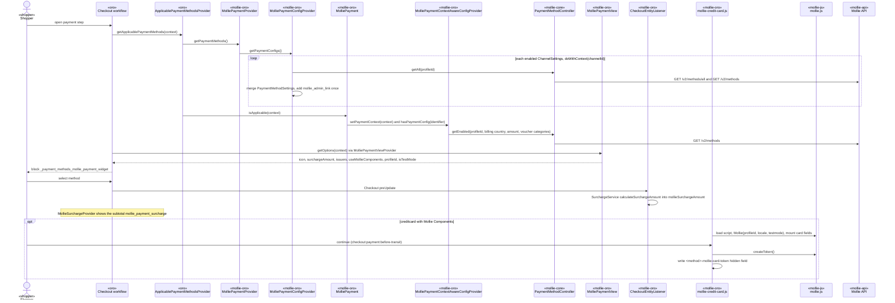

### 5.2 Payment creation on purchase

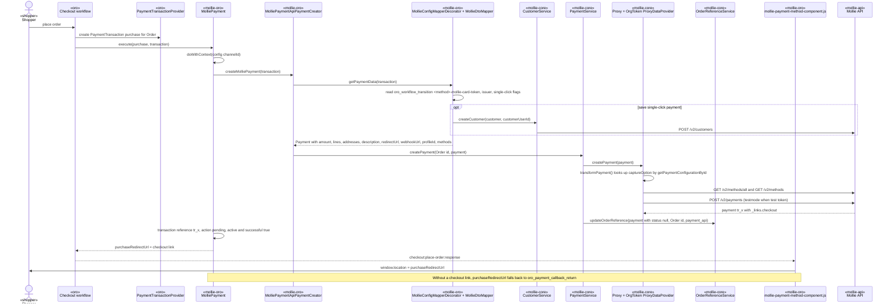

### 5.3 Redirect return

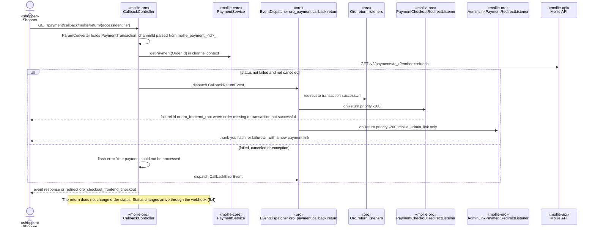

### 5.4 Webhook status update

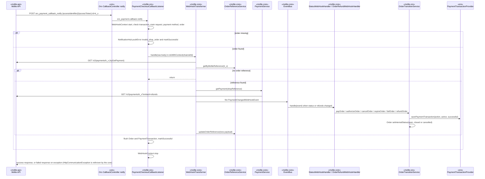

### 5.5 Admin order detail: manual capture

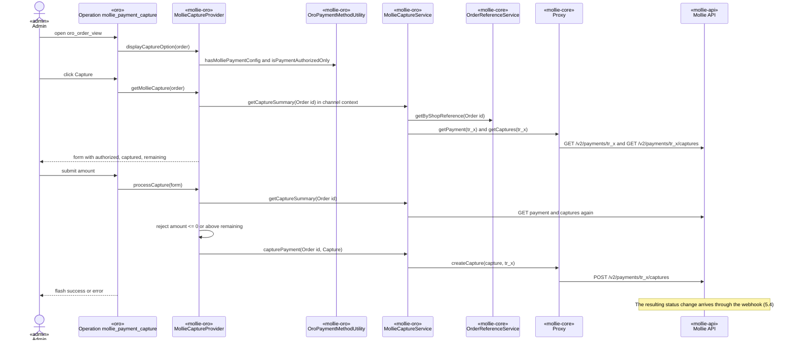

### 5.6 Admin order detail: refund

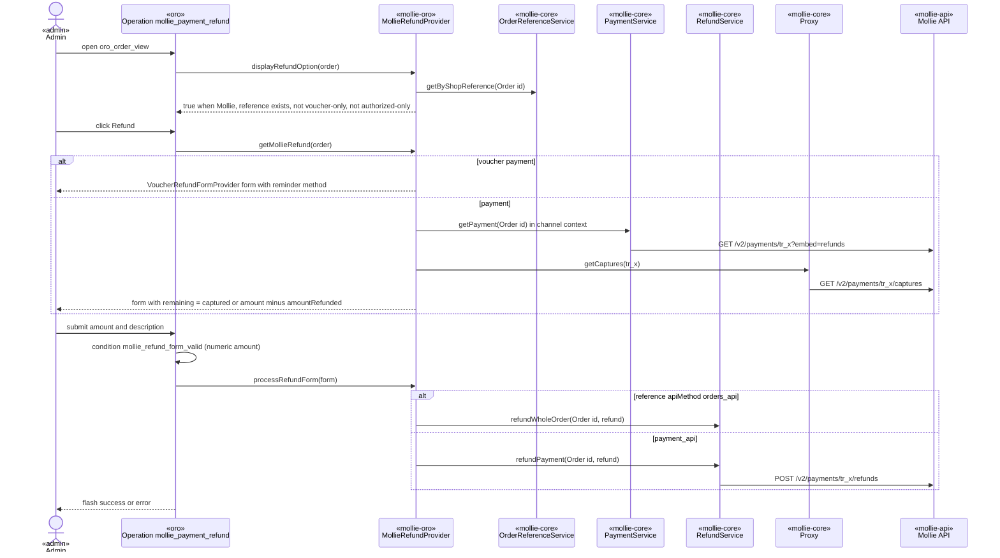

### 5.7 Admin payment link

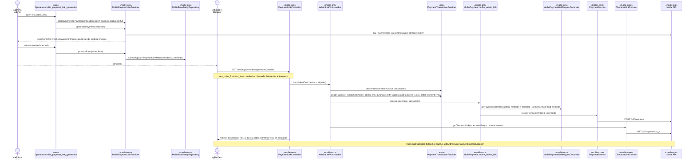

### 5.8 Back-office order changes: cancel, total, lines, address, close, delete

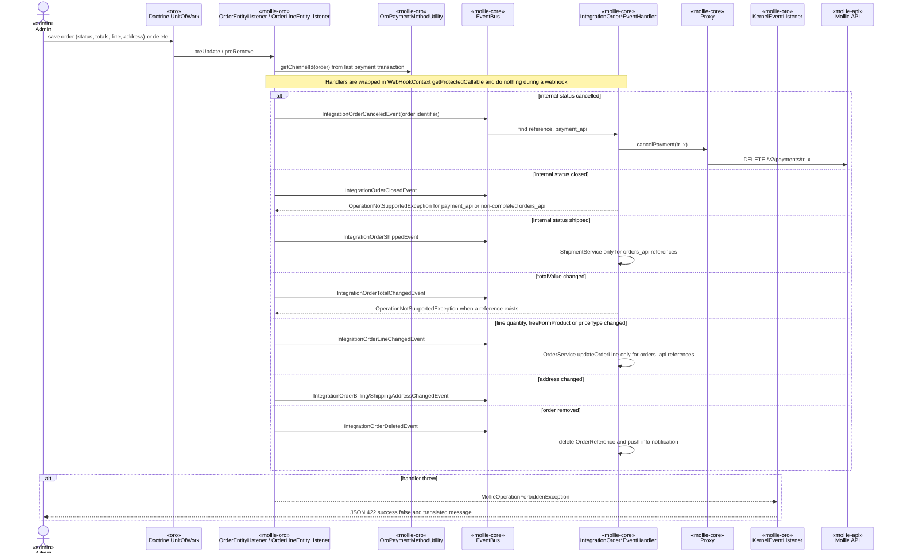

### 5.9 Connect and configuration (integration channel)

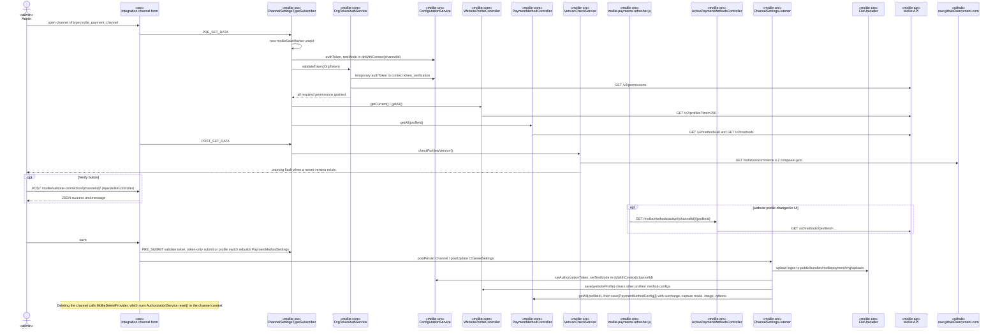

## 6. Module map

| Path | Responsibility | Key entry points |
|---|---|---|
| `composer.json` | Package `mollie/orocommerce` 6.2.3, `type: symfony-bundle`, requires `php >=8.1` and `oro/commerce ^6.0`, PSR-4 `Mollie\Bundle\PaymentBundle\` → repository root | — |
| `MolliePaymentBundle.php` | Bundle class. Boots the core bootstrap. | `boot()`, `getContainerExtension()` |
| `DependencyInjection/` | `PaymentExtension` loads `services.yml` and `listeners.yml` | `load()` |
| `IntegrationServices/` | Composition root and core boundary implementations | `BootstrapComponent`, `ConfigurationService`, `OrderTransitionService`, `OrderLineTransitionService`, `LoggerAdapter`, `LoggerService`, `VersionCheckService`, `TransactionDescriptionService`, `PlatformVersionReader`, `FileUploader`, `DebugService` |
| `IntegrationCore/` | Copied, re-namespaced core (integration-core 1.3.4 base with local edits) | `BusinessLogic/BootstrapComponent.php`, `BusinessLogic/Http/Proxy.php`, `BusinessLogic/Http/OrgToken/ProxyDataProvider.php`, `BusinessLogic/WebHook/WebHookTransformer.php`, `Infrastructure/ServiceRegister.php` |
| `Integration/` | Oro integration channel type and transport | `MolliePaymentChannelType`, `MolliePaymentTransport` |
| `Entity/` | Doctrine entities, the core-ORM entity `PaymentLinkMethod`, repositories and the extend generator extension | `ChannelSettings`, `PaymentMethodSettings`, `MollieBaseEntity`, `Repository/*`, `GeneratorExtension/MollieSurchargeAwareEntityGeneratorExtension` |
| `PaymentMethod/` | Oro payment method, providers, factories, config, views, payment creators | `MolliePayment`, `Provider/MolliePaymentProvider`, `Factory/MolliePaymentPaymentMethodFactory`, `Config/Provider/*`, `Config/Factory/PaymentConfigFactory`, `View/*`, `Config/CaptureModeRestrictions` |
| `Mapper/` | Oro → Mollie DTO mapping and the checkout-to-order mapper decorator | `MollieDtoMapper`, `OrderMapperDecorator` |
| `Manager/` | Services behind operations, controllers and placeholders | `MollieCaptureProvider`, `MollieCaptureService`, `MollieRefundProvider`, `VoucherRefundFormProvider`, `MolliePaymentLinkProvider`, `AdminLinkVisitHandler`, `OroPaymentMethodUtility`, `MollieDeleteProvider`, `ProductAttributesProvider`, `ProductAttributeResolver` |
| `Controller/` | Bundle routes | `CallbackController`, `PaymentLinkController`, `AjaxMollieController`, `ActivePaymentMethodsController`, `SupportController` |
| `EventListener/` | Doctrine, kernel, datagrid, surcharge and payment-callback listeners | `Callback/*`, `ChannelSettingsListener`, `CheckoutEntityListener`, `OrderEntityListener`, `OrderLineEntityListener`, `DatagridsListener`, `MollieSurchargeListener`, `KernelEventListener` |
| `Form/` | Channel and method settings forms, operation form entities and types | `Type/ChannelSettingsType`, `Type/PaymentMethodSettingsType`, `EventListener/ChannelSettingsTypeSubscriber`, `Type/MollieCaptureType`, `Type/MollieRefundType`, `Type/MolliePaymentLinkType` |
| `Condition/` | Action condition `mollie_refund_form_valid` | `RefundFormValid` |
| `Provider/` | Subtotal provider `mollie_payment_surcharge` | `MollieSurchargeProvider` |
| `Exceptions/` | `MollieOperationForbiddenException` (→ JSON 422) | — |
| `Migrations/` | Installer `v1_0`, schema `v1_1`, `v1_2`, data fixtures | `Schema/MolliePaymentBundleInstaller`, `Data/ORM/*` |
| `Resources/config/` | DI (`services.yml`, `listeners.yml`), back-office JS modules (`jsmodules.yml`) and Oro config (`oro/actions.yml`, `assets.yml`, `bundles.yml`, `datagrids.yml`, `placeholders.yml`, `routing.yml`, `twig.yml`) | — |
| `Resources/views/` | Operation templates (`Action/`), channel form themes (`Form/`), notification severity, voucher label placeholder, storefront layout block themes | `layouts/default/imports/oro_payment_method_options`, `layouts/default/imports/oro_payment_method_order_submit` |
| `Resources/public/` | JS components and views, SCSS, `img/mollie-logo.png` | `js/app/components/*`, `js/app/views/*`, `css/scss/main.scss`, `default/scss/styles.scss` |
| `Resources/translations/` | `messages.{en,de,de_DE,fr,fr_FR,nl,nl_NL}.yml`, keys `mollie.payment.*` | — |
| `Tests/Unit/` | Unit tests of the copied core (`BusinessLogic`, `Infrastructure`), 88 PHP files | `Common/BaseTestWithServices`, `Infrastructure/Common/TestServiceRegister` |
| `.github/workflows/codeql.yml` | CodeQL analysis of JavaScript on `master` pushes and PRs | — |
| `.github/workflows/acl-attributes.yml` | Fails on `master` pushes and PRs when `#[Acl`, `#[AclAncestor` or `#[CsrfProtection` appears inside a docblock | — |

## 7. Key patterns & conventions

- **Composition root: the Symfony container and the core `ServiceRegister`, bridged in both directions.**
  - The Symfony container is the primary DI container. `services.yml` and `listeners.yml` define every wrapper service with explicit arguments; there is no autowiring.
  - Wrapper → core: `MolliePaymentBundle::boot()` calls `IntegrationServices\BootstrapComponent::boot($container)` on every kernel boot. It registers lazy closures that return the container's `Configuration`, `ShopLoggerAdapter`, `OrderTransitionService`, `OrderLineTransitionService`, `AuthorizationService`, `OrgToken\ProxyDataProvider` and `VersionCheckService`. It also registers the container itself under `ContainerInterface::class`, which `MollieBaseEntityRepository::getEntityManager()` uses to reach `oro_entity.doctrine_helper`.
  - Core → Symfony: core singletons are exposed as public Symfony services through `factory: [<CoreClass>, getInstance]`. These are `CheckoutLinkService`, `PaymentMethodService`, `OrderReferenceService`, `OrderService`, `RefundService`, `PaymentService`, `WebHookTransformer`, `EventBus` and `OrgTokenAuthService` (as the `AuthorizationService` id). Stateless core classes (`WebsiteProfileController`, `PaymentMethodController`, `NotificationController`, `OrgToken\ProxyDataProvider`) are plain public services.
  - Wrapper subclasses of core singletons get Symfony dependencies through static `create()` factories that configure the singleton instance: `ConfigurationService::create`, `LoggerAdapter::create`, `VersionCheckService::create` and `TransactionDescriptionService::create`. The Symfony service and the `ServiceRegister` entry are therefore the same object.
  - Preferred pattern: define wrapper services in `services.yml`/`listeners.yml` with constructor arguments, and inject core services by their FQCN service ids. Register a service in `BootstrapComponent::initServices()` only when core code must resolve it through `ServiceRegister`. Core code keeps resolving its collaborators with `ServiceRegister::getService(X::CLASS_NAME)`.
  - Existing deviations: wrapper classes call `ServiceRegister::getService()` directly. This happens in `CallbackController`, `CheckoutEntityListener`, `MolliePaymentView`, `MollieDtoMapper`, `MollieCaptureService`, `MollieRefundProvider` and `MollieContextAwareEntityRepository`. `RepositoryRegistry::getRepository()` is called in `MolliePaymentLinkProvider`, `MolliePaymentContextAwareConfigProvider` and `DebugService`.
- **Channel context scoping.** One Oro integration channel equals one Mollie organization token and one website profile. Every per-channel operation runs inside `Configuration::doWithContext((string)$channelId, fn)`. The channel id comes from the `MolliePaymentConfig` (`getChannelId()`), from `OroPaymentMethodUtility::getChannelId($order)` (last payment transaction), or from the `mollie_payment_<id>_` identifier prefix (`CallbackController`). `authToken`, `testMode` and `websiteProfile` are context-specific `ConfigEntity` rows. `PaymentMethodConfig` and `Notification` rows are stamped with the context by `MollieContextAwareEntityRepository`. `OrderReference`, `CustomerReference` and `PaymentLinkMethod` are global rows keyed by Oro ids.
- **Core boundary interfaces.** The core reaches Oro only through the implementations listed in §2. Webhook status changes reach Oro only through `OrderTransitionService`/`OrderLineTransitionService`, which the core webhook handlers call via `EventBus`. Order changes made in Oro reach the core only as `IntegrationOrder*Event`s fired by `OrderEntityListener`/`OrderLineEntityListener`. Admin capture and refund call wrapper managers, which call core services or `Proxy` directly.
- **Oro payment method pattern.** The Oro provider/factory/view triple is used: `MolliePaymentProvider` (`AbstractPaymentMethodProvider`) and `MolliePaymentViewProvider` (`AbstractPaymentMethodViewProvider`), both fed by `MolliePaymentConfigProvider`, create `MolliePayment` and `MolliePaymentView` per `MolliePaymentConfig` through their factories. Identifiers come from the Oro `prefixed_identifier_generator` with prefix `mollie_payment`, suffixed with `_<mollieId>`. Payment creation strategies implement `MolliePaymentCreatorInterface`. DTO customization is layered through `MollieDtoMapperInterface` decorators.
- **Settings persistence through transient fields and a save marker.** `ChannelSettings` maps only `mollieSaveMarker`. `ChannelSettingsTypeSubscriber::onPreSetData` sets it to a new `uniqid()` on every form load, so Doctrine always sees a change and fires `ChannelSettings` `postUpdate`. `ChannelSettingsListener` then writes the transient token, profile and method options into core entities.
- **Persistence: Doctrine through the Oro entity manager.** Core entities go into one generic table, `mollie_entity`, through the core `RepositoryInterface` implementations. Queries are DQL strings built by `MollieBaseEntityRepository`. Wrapper entities use Doctrine annotations (`@ORM\…`). Schema is owned by Oro migrations (`Installation` + versioned `Migration` classes). Extended fields (`mollie_surcharge_amount`, `mollie_voucher_category`) are added through `ExtendExtension`/extend options. Order status writes go through `Order::setInternalStatus()` and are flushed by `PaymentCheckoutCallbackListener`. Transaction writes go through `PaymentTransactionProvider::savePaymentTransaction()`.
- **Request routing.** All routes are Symfony annotation routes, loaded through `Resources/config/oro/routing.yml`:
  - Storefront (`frontend: true`): `mollie_payment_callback_return` and `mollie_payment_link`.
  - Back office: `mollie_payment_validate_connection`, `mollie_active_payment_methods`, `mollie_payment_support_status`, `mollie_payment_support_status_update` and `mollie_payment_support_download_debug`.
  - Access: every action reuses an existing Oro ACL id through `#[AclAncestor]` (`@AclAncestor` on `5.0`) placed outside the docblock: `oro_integration_view` for the reads (on the channel itself for `mollie_active_payment_methods`, through its `@ParamConverter`), `oro_integration_update` for the debug download and, with `#[CsrfProtection]`, for the two POSTs, `oro_order_frontend_view` for `mollie_payment_link`. `mollie_payment_callback_return` has no ACL; it is keyed by the unguessable transaction `accessIdentifier`.
  - The webhook uses Oro's own `oro_payment_callback_notify` route and event `oro_payment.callback.notify`.
  - Admin order actions are Oro operations on `oro_order_view`, with `@call_service_method` actions on public manager services.
- **Echo suppression.** `WebHookContext::start()`/`stop()` wrap webhook handling. Core `IntegrationOrder*` event subscriptions are registered through `WebHookContext::getProtectedCallable()`, so status writes made during a webhook do not fire back to Mollie. `OrderEntityListener` sets `orderChangeIsProcessing` to handle one change per flush. `OrderLineEntityListener::setHandleLineEvent(false)` is set by `MolliePayment::purchase()` (redirect fallback) and by total changes.
- **Error surfacing.**
  - Core `NotificationHub` notifications are stored in `mollie_entity` through a separate entity manager and shown in `mollie-notifications-grid` on the channel form.
  - Back-office order changes rejected by the core become `MollieOperationForbiddenException`, which `KernelEventListener` turns into a JSON 422 response.
  - Operations report through `@flash_message`. Storefront errors use Symfony flash bags.
  - Controllers and managers catch exceptions and return result arrays or fallback redirects.
- **Logging.** `Logger::logX()` (core) writes through `LoggerAdapter` → `LoggerService` to Monolog channel `mollie`. There is no wrapper UI for the log level, so the core default `getMinLogLevel()` applies. `debugModeEnabled` (set through `mollie_payment_support_status_update`) logs everything and enables the webhook URL replacement.
- **API selection and capture.** New payments use only the Payments API (`PaymentMethodConfig::API_METHOD_PAYMENT`): `PaymentMethodController::getEnabled` checks availability against the Payments API, and the method factory always builds `MolliePaymentApiPaymentCreator`. Orders API references created by earlier versions stay supported for refund (`refundWholeOrder`), webhook (`OrderChangedWebHookEvent`), shipment, line update and checkout link. The capture mode per method is `automatic` or `manual` (`captureOption` → `captureMode` in `transformPayment`). `CaptureModeRestrictions::AUTOMATIC_ONLY` (20 method ids) hides the selector. Authorized payments are captured only through the `mollie_payment_capture` operation.
- **Naming.**
  - Wrapper classes live under `Mollie\Bundle\PaymentBundle\<Area>\<Name>`, with a `Mollie` prefix for Oro-facing classes.
  - Core boundary implementations live in `IntegrationServices/`. Core classes stay under `…\IntegrationCore\BusinessLogic|Infrastructure\…`.
  - Service ids are `mollie_payment.<area>.<name>`, or the FQCN for core-bound services.
  - The channel type is `mollie_payment_channel`, the transport `mollie_payment_transport`.
  - Translation keys are `mollie.payment.*`, including the core notification keys `mollie.payment.webhook.notification.*` and `mollie.payment.integration.event.notification.*`.
- **Translations.** `Resources/translations/messages.<locale>.yml` for `en`, `de`, `de_DE`, `fr`, `fr_FR`, `nl`, `nl_NL`, all in the `messages` domain. Core `NotificationText` keys are translated by the grid (`type: translatable`).
- **JS and assets.**
  - Storefront modules (`Resources/views/layouts/default/config/jsmodules.yml`): `mollie-credit-card`, `mollie-issuer`, `mollie-applepay`, `mollie-order-submit` and `mollie-payment-method-component`. The last one redirects to `purchaseRedirectUrl` on `checkout:place-order:response`.
  - Back-office modules (`Resources/config/jsmodules.yml`): `mollie-payment-link-generator`, `mollie-form-refresher`, `mollie-accordion-view`, `mollie-payments-refresher` and `mollie-tabs-view`.
  - Mollie.js is loaded at runtime with `scriptjs("https://js.mollie.com/v1/mollie.js")`.
  - SCSS entry points are `css/scss/main.scss` (back office, `oro/assets.yml`) and `default/scss/styles.scss` (storefront layout theme).
  - The layout block themes override `oro_payment_method_options` and `oro_payment_method_order_submit`.
- **Migrations.** The Oro installer returns `v1_0`, so `v1_1` and `v1_2` run after it on a fresh install and in order on upgrades. Data fixtures in `Migrations/Data/ORM` declare dependencies on Oro product fixtures and on each other.

## 8. External boundaries

| Boundary | Direction | Details |
|---|---|---|
| Mollie API v2 (`https://api.mollie.com/v2/`; reference: https://docs.mollie.com/reference/overview) | outbound | Calls go through core `Proxy` + `LoggingHttpClient(CurlHttpClient)` with the channel's organization token (`ConfigEntity authToken`). `OrgToken\ProxyDataProvider` adds `testmode` to GET query strings and request bodies, and adds `profileId` where needed. The calls are: - `GET permissions` (token validation) - `GET profiles?limit=250` (website profiles) - `GET methods/all` + `GET methods` (config provider per channel, channel form, `getPaymentConfigurationById` on every payment creation) - `GET methods` with amount, billing country and order line categories (`isApplicable`, issuers, payment link methods) - `GET methods?profileId=` (active-methods endpoint) - `POST customers` (single-click) - `POST payments` - `GET payments/{id}?embed=refunds` (return, webhook ×2, capture/refund forms, checkout link) - `DELETE payments/{id}` (order cancel) - `GET` and `POST payments/{id}/captures` - `POST payments/{id}/refunds` - for Orders API references created by earlier versions only: `GET orders/{id}`, `DELETE orders/{id}`, `PATCH orders/{id}/lines/{lineId}`, `POST orders/{id}/refunds`, `POST orders/{id}/shipments` |
| Mollie webhook → Oro `oro_payment_callback_notify` (access identifier + access token of the `PaymentTransaction`) | inbound | Form POST with `id`. There is no signature. Oro checks the transaction access token. Authenticity of the data comes from fetching the payment back from the API. `PaymentCheckoutCallbackListener` marks the Oro callback event successful after processing. Exceptions, including the `HttpCommunicationException` the core rethrows, leave it failed, so Mollie retries. |
| Mollie hosted checkout → `mollie_payment_callback_return` (`/payment/callback/mollie/return/{accessIdentifier}`) | inbound (browser) | `redirectUrl` of every payment. Fetches the payment and dispatches the Oro return or error callback event. It does not write order status. |
| Admin payment link → `mollie_payment_link` (`/mollie/paymentlink/generate/{orderId}`, storefront) | inbound (browser) | Creates a `mollie_admin_link` transaction and payment, then redirects to the Mollie checkout link. The URL is rewritten to the order website's URL by `WebsiteUrlResolver`. |
| Mollie Components (`https://js.mollie.com/v1/mollie.js`) | browser | Loaded by `mollie-credit-card.js`. Card tokenisation with `profileId`, `testmode` and the page `lang`. The token travels as `oro_workflow_transition[<method>-mollie-card-token]`. |
| Apple Pay (`window.ApplePaySession`) | browser | `mollie-applepay.js` hides Apple Pay when `ApplePaySession.canMakePayments()` is not available. |
| Mollie dashboard and help (`https://www.mollie.com/dashboard/developers/organization-access-tokens`, `https://help.mollie.com/hc/en-us`) | browser links | Token link on the authorization form. Support link in `Form/fields.html.twig`. |
| Version metadata (`ConfigurationService::VERSION_CHECK_URL` = `https://raw.githubusercontent.com/mollie/orocommerce/4.2/composer.json`, `PLUGIN_DOWNLOAD_URL` = `https://github.com/mollie/orocommerce/releases`) | outbound | `VersionCheckService::checkForNewVersion()` runs on every channel form `POST_SET_DATA` through `VersionCheckProxy` (no token header) and flashes a warning with the release tag URL when the fetched `version` is greater than `getExtensionVersion()`. |
| Oro platform extension points | in-process | Tags: - `oro_payment.payment_method_provider`, `oro_payment.payment_method_view_provider` - `oro_integration.channel`, `oro_integration.transport`, `oro_integration.delete_provider` - `oro_pricing.subtotal_provider`, `oro_action.condition`, `oro_entity_extend.entity_generator_extension` - `doctrine.orm.entity_listener`, `doctrine.repository_service`, `monolog.logger`, `form.type`, `kernel.event_listener` (`kernel.exception`, `oro_payment.callback.notify`, `oro_payment.callback.return`, `oro_payment.event.collect_surcharge`, `oro_datagrid.datagrid.build.after.mollie-notifications-grid`) Service decoration: `oro_checkout.mapper.order_mapper`. Oro config files: `actions.yml` (operations on `oro_order_view`), `placeholders.yml` (`view_general_section_after`), `datagrids.yml`, `assets.yml`, `jsmodules.yml`, `bundles.yml`, `twig.yml`, and the layout `setBlockTheme` imports. Services used: `PaymentTransactionProvider`, `PaymentStatusProvider`, `ApplicablePaymentMethodsProvider`, `CompositePaymentMethodProvider`, `TaxProviderRegistry`, `SurchargeProvider`, `LocalizationHelper`, `WebsiteManager`, `WebsiteUrlResolver`, `PackageProvider`, `AclHelper`, `DoctrineHelper`, `ConfigModelManager`, `EntityAliasResolver`, `LocaleExtension`, `PriceRoundingService`. |
| Filesystem | local | Method logos in `%kernel.project_dir%/public/bundles/molliepayment/img/uploads`. The debug ZIP reads `%kernel.logs_dir%` and writes a temp file, which is deleted after it is sent. |

## 9. Known constraints

- **PHP floor 8.1 for the shared code.** `composer.json` requires `php >=8.1` on both branches, and
  the `5.0` branch runs on OroCommerce 5.0, which requires PHP `~8.1.0` (oroinc/platform 5.0.0
  `composer.json`). OroCommerce itself raises the effective version on `master`: 6.0 requires PHP
  `~8.3.0` and 6.1 `~8.4.0` (oroinc/orocommerce 6.0.0 / 6.1.0 `composer.json`). Code that is ported
  between the branches stays on PHP 8.1 syntax. The wrapper uses up to PHP 8.0 syntax today (typed
  properties, the nullsafe operator, for example `IntegrationServices/VersionCheckService.php:54`).
- **OroCommerce range.** `master`: `oro/commerce ^6.0` (6.0 and 6.1). `OrderTransitionService::getInternalStatus()`
  resolves order statuses through `EnumOption` when that class exists (it exists in oroinc/platform
  6.1.0, not in 6.0.0) and falls back to the extend enum value class otherwise. `5.0`: `oro/commerce ^5.0`.
- **Core as a manual copy, never edited in place.** The core is included as a manual, re-namespaced
  copy of `mollie/integration-core` under `IntegrationCore/`
  (`Mollie\Bundle\PaymentBundle\IntegrationCore\BusinessLogic|Infrastructure\…`), autoloaded through the
  bundle's PSR-4 root, not as a Composer dependency. The last full re-copy was core 1.3.4 (commit
  `0fabda3`). A core change is made in `mollie/integration-core`, released there, and re-copied in
  full with the namespace rewritten; the re-copy is reviewed as a diff. Wrapper-specific code lives
  outside `IntegrationCore/`.
- **Multi-channel scoping.** Each enabled Oro integration channel of type `mollie_payment_channel`
  carries its own organization token, test mode, website profile and method configs, scoped by the
  channel id as core context. `ConfigurationService::isSystemSpecific()` returns `false`, so there is
  no per-website scoping of configuration. `ChannelSettingsRepository::getEnabledSettings()` applies
  the Oro `AclHelper`, so the visible channels follow Oro organization ACL. `OrderReference`,
  `CustomerReference` and `PaymentLinkMethod` are keyed by Oro entity ids and are not channel-scoped.
  `minLogLevel`, `defaultLoggerEnabled` and `debugModeEnabled` are global.
- **Branches.** Two maintained branches with identical AI resources (`CLAUDE.md` § Supported branches):
  - `master`: OroCommerce 6.x, module line `6.x.y`, primary (changes land here first)
  - `5.0`: OroCommerce 5.x, module line `5.x.y`, receives ported changes
- **Verification.** `Tests/Unit` holds unit tests for the copied core only (88 PHP files under
  `BusinessLogic/` and `Infrastructure/`, with their own `TestServiceRegister`, in-memory repositories
  and `TestHttpClient`). The repository has no `phpunit.xml`, no `require-dev` and no test job in CI;
  `.github/workflows/codeql.yml` runs CodeQL for JavaScript and `acl-attributes.yml` greps for ACL/CSRF
  attributes inside docblocks, both on `master` only. Wrapper code is verified
  manually on an OroCommerce install of the branch's version: connect a channel, run checkout, return
  and webhook, and exercise the capture, refund, payment link and order-change operations.
- **Packaging and version.** The package is installed with Composer from the Git repository.
  `composer.json` `version` is the release version. `ConfigurationService::getExtensionVersion()`
  reports the installed `mollie/orocommerce` package version from Oro `PackageProvider` and falls
  back to the container parameter `mollie_payment.version` (`Resources/config/services.yml:2`).
