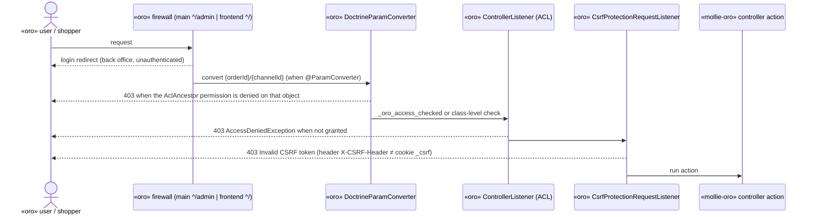

# PIORO-225 — Plan: enforce ACL/CSRF on the bundle's controller actions

## 1. Title + summary

Realizes `docs/specs/PIORO-225/spec.md` (research: `research.md`). It turns the inert docblock
`#[Acl]` / `#[AclAncestor]` / `#[CsrfProtection]` lines into real Oro 6 attributes, adds the missing
ACL to the active-methods endpoint, makes the debug download work on Symfony 6.4, fixes the admin-link
failure flash, and adds a CI guard against recurrence.

- **Branches:** work on `bugfix/PIORO-225` (from `master`) and then on `bugfix/PIORO-225-5.0` (from
  `5.0`). No commit goes directly onto `master` or `5.0`; the developer merges (spec § Branches and merge).
- **Core:** no `mollie/integration-core` change, no `IntegrationCore/` re-copy.
- **Out of scope:** payment-link token for guests, moving the payment-link state change off GET,
  reducing the debug ZIP, `.gitattributes`/CRLF of `plan-gate.sh`.

## 2. Decisions

All locked in the spec (§ Decisions). Implementation-level choices:

| Choice | Why |
|---|---|
| `#[AclAncestor('<existing id>')]` everywhere, no `#[Acl]` | Reuses Oro's `oro_integration_view` / `oro_integration_update` / `oro_order_frontend_view`; `#[Acl]` with an existing id silently overwrites Oro's definition (research §2.5). Matches Oro's own `IntegrationController` L57-64 |
| Keep `@Route` / `@ParamConverter` in the docblock | They are read by the annotation route loader (`routing.yml` `type: annotation`) and Sensio, which still work on Oro 6 (research §2.8). Converting routes is unrelated churn |
| Attributes placed between the docblock and the method | PHP attribute syntax; satisfies `.claude/rules/languages/php/CLAUDE.md` § Access Control and CSRF (`strict`) |
| `DebugService` as a constructor argument of `SupportController` | DI convention (`CLAUDE.md` § Local rules); `AbstractController::get()` is gone in Symfony 6.4 (research §1.3) |
| `profileId` requirement `[A-Za-z0-9_]+` | Must accept real ids (`pfl_…`) and the `mollieProfileId` placeholder that `website-profile.html.twig` passes to `path()`; a stricter `pfl_` pattern would break URL generation |
| `?Channel $channel = null` in the touched `validateConnectionAction` signature | PHP 8.4 deprecates implicit nullable (`CLAUDE.md` § Local rules) |
| CI guard: plain `grep` in a workflow, `actions/checkout` pinned by SHA (`11bd71901bbe5b1630ceea73d27597364c9af683`, v4.2.2, from `git ls-remote`), `permissions: contents: read`, `persist-credentials: false`, `pull_request` trigger (no `pull_request_target`) | `.claude/rules/cicd/github-actions/CLAUDE.md` (pinning, minimal token, fork PRs). No third-party action, no secrets, no untrusted `${{ }}` in `run:` |
| `php -l` and an attribute check via the official Docker images `php:8.1-cli` and `php:8.4-cli` | PHP is not installed in this environment; Docker is |

## 3. Architecture impact

**Business-case-only** (security hardening of existing entry points). No new component, flow,
persistence, external call or core change. The routes stay the same; their access rules change.
`DESIGN.md` is updated where it describes these endpoints (it is the living record):

- §2 component table row `AjaxMollieController, ActivePaymentMethodsController, SupportController` →
  add the ACL / CSRF each endpoint requires.
- §2 row `MolliePaymentLinkProvider, AdminLinkVisitHandler, PaymentLinkController` and §5.7 diagram →
  the storefront route requires `oro_order_frontend_view` (VIEW on that order; guests denied).
- §8 "Existing deviations" → drop the `$this->get(DebugService::class)` sentence.
- §8 "Request routing" → note the ACL per route.
- `CLAUDE.md`: § Commands (CI now has the docblock-attribute guard) and § Supported branches
  `.github/workflows` row (`master`: `codeql.yml` + `acl-attributes.yml`).
- `LEARNINGS.md`: entry for the trap.

## 4. Risks & emphasis

| Dimension | Risk | Mitigation |
|---|---|---|
| Security | Attribute still not applied (typo, wrong class, cache) | Tokenizer check that each action has a `T_ATTRIBUTE` with the expected name and no docblock contains `#[Acl…`; CI guard; manual 403 checks; `oro:platform:update` rebuilds `acl_attributes.php` |
| Security | Validate connection for a new channel (`channelId` 0): param converter returns null → class-level `EDIT` check | Manual check "Verify" on a new, unsaved channel as admin |
| Security | `profileId` / `channelId` unvalidated | Route requirements; non-matching URL → 404 |
| Security | Debug ZIP still contains `phpinfo()` and all logs | Accepted in spec; access now needs Integration VIEW. ASVS 13.2/14.1 noted as residual in hand-off |
| Money/state | Payment link: denied requests must not create transactions | ACL runs on `kernel.controller` / in the param converter, before the action body (research §2.2, §2.8) |
| Backward compat | Guests and sessionless shoppers lose the admin payment link on `master` | Accepted in spec (same as `5.0`); mentioned in release notes/hand-off |
| Backward compat | Staff with restricted roles lose debug/verify access | Accepted; admins keep it |
| Compatibility | PHP 8.1 floor; Oro 6.0 vs 6.1 | Attributes and signatures identical in 6.0.0/6.1.0 (research intro); only PHP 8.0 syntax used; `php -l` on 8.1 and 8.4 |
| Compatibility | `5.0` port uses annotations, `$this->get()` stays | Port tasks adapt by hand (`PRINCIPLES.md` §7) |
| Performance | none | ACL check is one voter call per request |
| Alignment | Controllers stay thin; DI explicit | Only attributes and constructor injection change |

## 5. Model / flow diagrams

Access check order for an action after the fix (applies to all five Oro 6 actions):



Why: it shows that every rejection happens before the action body, so a denied payment-link request
never deactivates or creates transactions (spec acceptance 3).

## 6. Persistence changes

None.

## 7. Class outline

| Class | Change |
|---|---|
| `Controller/SupportController.php` | Constructor `__construct(Configuration $configService, DebugService $debugService)`; `#[AclAncestor('oro_integration_view')]` on `getDebugStatus` and `downloadDebugData`; `#[AclAncestor('oro_integration_update')]` + `#[CsrfProtection()]` on `updateDebugStatus`; `downloadDebugData` uses `$this->debugService`. Imports: `AclAncestor`, `CsrfProtection` (drop unused `Acl`). Docblocks keep `@Route` and `@return` only |
| `Controller/AjaxMollieController.php` | `#[AclAncestor('oro_integration_update')]` + `#[CsrfProtection()]` on `validateConnectionAction(Request $request, ?Channel $channel = null)` |
| `Controller/PaymentLinkController.php` | `#[AclAncestor('oro_order_frontend_view')]` on `goToMolliePaymentPage(Order $order)` |
| `Controller/ActivePaymentMethodsController.php` | `#[AclAncestor('oro_integration_view')]`; `@Route(..., requirements={"channelId"="\d+", "profileId"="[A-Za-z0-9_]+"})` |
| `EventListener/Callback/AdminLinkPaymentRedirectListener.php` | `redirectToFailureUrl`: `$this->requestStack->getSession()?->getFlashBag()->add('error', …)` |
| `Resources/config/services.yml` | `SupportController` arguments: add `'@Mollie\Bundle\PaymentBundle\IntegrationServices\DebugService'` |
| `.github/workflows/acl-attributes.yml` (new) | Job `check` on `ubuntu-latest`, `timeout-minutes: 5`: checkout (pinned), then `grep -rnE --include='*.php' --exclude-dir=IntegrationCore --exclude-dir=Tests --exclude-dir=.git '^\s*(/\*\*|\*).*#\[(Acl|AclAncestor|CsrfProtection)\b' .` → fail with the hits when found |

Example (shape for every action):

```php
    /**
     * @Route("/support/status", name="mollie_payment_support_status_update", methods={"POST"})
     *
     * @param Request $request
     * @return JsonResponse
     */
    #[AclAncestor('oro_integration_update')]
    #[CsrfProtection()]
    public function updateDebugStatus(Request $request)
```

## 8. Files

`master`: the six PHP/YAML files in §7, `.github/workflows/acl-attributes.yml`, `DESIGN.md`,
`CLAUDE.md`, `LEARNINGS.md`, `composer.json` (release), `docs/specs/PIORO-225/*`.

`5.0`: `Controller/SupportController.php` (`@AclAncestor("oro_integration_update")` + `@CsrfProtection()`
on `updateDebugStatus`, `Annotation\` imports), `Controller/ActivePaymentMethodsController.php`
(`@AclAncestor("oro_integration_view")` + requirements), the AI resources and spec folder (unchanged
copies from `bugfix/PIORO-225`), `composer.json` + `README.md` (release).

## 9. Tasks

See `tasks.md`. Summary: T1 docs/spec commit → T2–T7 code and CI (sequential, one commit each) →
T8 docs → T9 verify + review → T10 release → P1–P5 on `bugfix/PIORO-225-5.0`.

## 10. Verification

Commands (in this environment, PHP via Docker):

```bash
# syntax, both PHP versions, changed files only
for v in 8.1 8.4; do docker run --rm -v "$PWD":/app -w /app php:$v-cli \
  sh -c 'for f in "$@"; do php -l "$f"; done' _ <changed .php files>; done

# no attribute inside a docblock (same command as the CI guard; expect no output, exit 1)
grep -rnE --include='*.php' --exclude-dir=IntegrationCore --exclude-dir=Tests --exclude-dir=.git \
  '^\s*(/\*\*|\*).*#\[(Acl|AclAncestor|CsrfProtection)\b' .

# attribute check: PhpToken script (scratchpad) listing, per Controller action, the T_ATTRIBUTE names
docker run --rm -v "$PWD":/app -v <scratchpad>:/s -w /app php:8.1-cli php /s/check-attributes.php Controller
```

CI guard self-test: run the grep against a scratch copy of `master`'s current `SupportController.php`
(must report hits) and against the fixed tree (must report none).

Manual script (Oro 6.0 or 6.1 app; then the `5.0` subset in Oro 5.x). Install the bundle from the
working copy, `php bin/console oro:platform:update --force`, `cache:clear`. Users: an administrator,
and a back-office user whose role has Integration VIEW but no EDIT, and one with neither.

| # | Step | Expected |
|---|---|---|
| 1 | No-Integration user: `GET /admin/mollie/support/status`, `/admin/mollie/support/download_debug_data`, `/admin/mollie/methods/active/<id>/<pfl>` | 403 each |
| 2 | VIEW-only user: same GETs | 200 JSON / ZIP download / JSON |
| 3 | VIEW-only user: `POST /admin/mollie/support/status` and `POST /admin/mollie/validate-connection/<id>/` with valid CSRF header | 403 |
| 4 | Admin: same POSTs without `X-CSRF-Header` (curl with session cookie) | 403 "Invalid CSRF token" |
| 5 | Admin: toggle debug from the browser console with jQuery `$.ajax` POST JSON `{"debugStatus": true}` | 200, `isDebugModeEnabled: true`; reset to false |
| 6 | Admin: download debug data | ZIP with `phpinfo.html`, `order-references.json`, `logs/` (no 500) |
| 7 | Admin: channel form "Verify" on an existing channel and on a new unsaved channel; change website profile | Success/fail message as before; method list refreshes |
| 8 | `/admin/mollie/methods/active/abc/x-y` | 404 |
| 9 | Payment link for an order of customer user A: open as guest (new browser) | Access denied / login, **no new payment transaction** on the order |
| 10 | Same link as customer user B (other customer) | 403, no new transaction |
| 11 | Same link as customer user A | Redirect to Mollie checkout; `mollie_admin_link` transaction created |
| 12 | Cancel the Mollie checkout from step 11 | Redirect to the failure URL with the admin-link error flash, no PHP error |

Review: `/code-review` → `/simplify` → `/security-review` on each branch's diff. ASVS checklist
(`asvs-l2.md`) answered in the hand-off.

Docs updated: `DESIGN.md`, `CLAUDE.md`, `LEARNINGS.md` (§3).

## 11. Done

- Commands above green on both branches (real output reported), CI guard self-test done.
- Manual script executed on Oro 6 and the `5.0` subset on Oro 5, or explicitly reported as not run
  (then the change is not done).
- Three reviews clean, ASVS checklist answered, docs in sync, `Release 6.2.4` / `Release 5.3.4` on the
  working branches. Nothing pushed.
